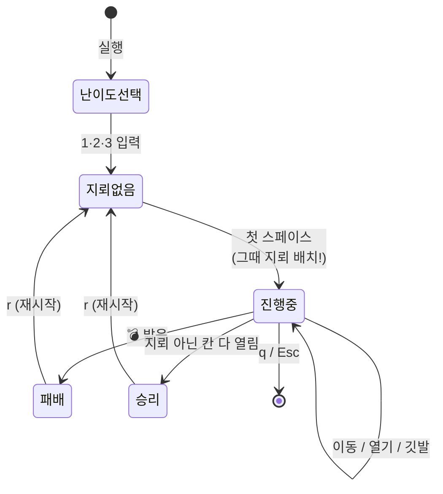
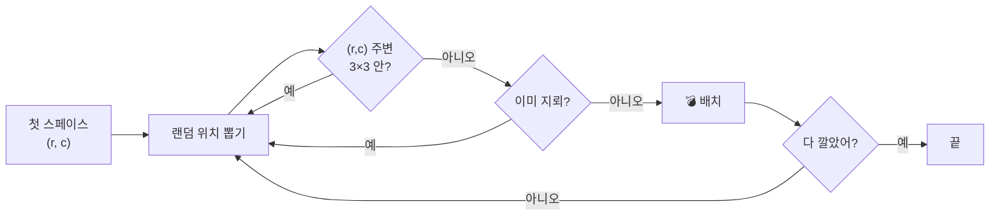
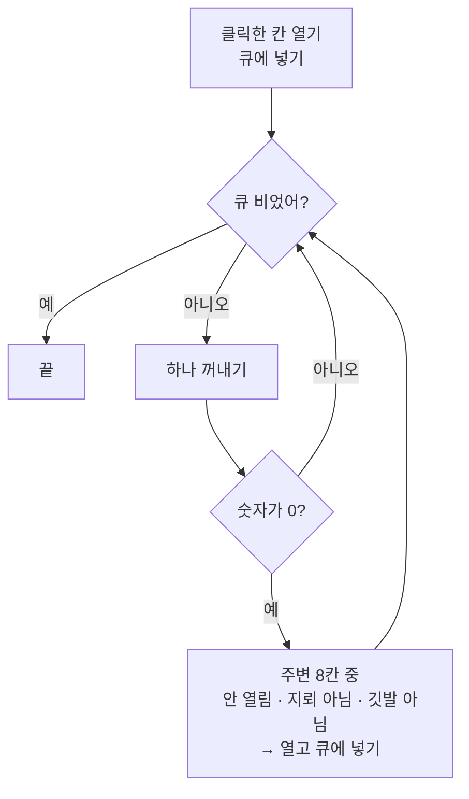

# 터미널 지뢰찾기 설계 문서

> **한 줄 요약:** 윈도우 지뢰찾기를 **터미널에서 방향키로** 하는 Go 프로그램이에요.

---

## ⏱️ 30초 요약

- ⌨️ **방향키로 이동**, 스페이스로 열기, `f`로 깃발
- 🎯 **첫 클릭은 절대 안 터져요** (첫 클릭 후에 지뢰를 깔아요)
- 🌊 빈칸을 열면 **주변이 쫙 퍼지며 열려요** (BFS)
- 🖥️ 화면은 **tcell** 라이브러리로 그려요

```bash
go run .
```

---

## 📚 목차

1. [파일 지도](#1-파일-지도)
2. [게임 한 판의 흐름](#2-게임-한-판의-흐름)
3. [핵심 알고리즘 3개](#3-핵심-알고리즘-3개)
4. [아직 부족한 점](#4-아직-부족한-점)

---

## 1. 파일 지도

| 파일 | 역할 | 비유 |
|---|---|---|
| `main.go` | 시작 버튼 | 🔌 |
| `cell.go` | 칸 하나의 상태 | 🟫 타일 |
| `board.go` | 지뢰 깔기, 숫자 세기, 펼치기 | 🧠 규칙 |
| `game.go` | 키 입력, 화면 그리기, 승패 | 🎮 진행자 |
| `utils.go` | `abs()` | 🔧 |

> 💡 **규칙(board)과 화면(game)을 나눴어요.** 그래서 `board.go`는 터미널을 전혀 몰라요. 나중에 GUI로 바꿔도 `board.go`는 그대로 쓸 수 있어요.

**칸 하나가 기억하는 것:**

```go
type Cell struct {
    IsMine   bool // 💣 지뢰야?
    Revealed bool // 👀 열렸어?
    Flagged  bool // 🚩 깃발 꽂혔어?
    Checked  bool // ✔️ 체크 표시 (예약)
    Adjacent int  // 🔢 주변 지뢰 수
}
```

---

## 2. 게임 한 판의 흐름



| 난이도 | 크기 | 지뢰 |
|---|---|---|
| 1 초급 | 9 × 9 | 10 |
| 2 중급 | 16 × 16 | 40 |
| 3 고급 | 16 × 30 | 99 |

---

## 3. 핵심 알고리즘 3개

### ① 🎯 첫 클릭 보호



- 처음 누른 칸 **+ 주변 8칸**에는 지뢰를 안 깔아요
- 그래서 첫 클릭은 항상 **0** → 넓게 펼쳐지면서 시작해요

### ② 🔢 숫자 세기 (거꾸로 세기)

보통은 "빈칸마다 주변 8칸을 세기"를 떠올리는데, 여기선 **거꾸로** 해요.

- 💣 **지뢰마다** 주변 8칸에 `+1`
- 지뢰는 칸 수보다 훨씬 적으니까 일이 줄어요

### ③ 🌊 빈칸 펼치기 (BFS)



- **숫자 칸에서 멈추고, 0인 칸에서만 계속 퍼져요** → 실제 지뢰찾기랑 똑같이 동작해요
- 재귀(DFS) 대신 **큐(BFS)** 를 써서 판이 커도 스택이 넘칠 걱정이 없어요

### 🎁 덤: 키 중복 입력 막기

- 같은 키가 **100ms 안에** 또 들어오면 무시해요
- 일부 터미널에서 한 번 눌러도 두 번 들어가는 문제가 있어서 넣었어요

---

## 4. 아직 부족한 점

- [ ] 💥 난이도에 **1·2·3 말고 다른 값**을 넣으면 0×0 판이 만들어져서 바로 죽어요 → 다시 묻거나 기본값으로 처리해야 해요
- [ ] ✔️ `Checked` 칸 상태는 그리기·펼치기 코드에 있지만 **켜는 키가 없어요** (기능을 되돌린 흔적)
- [ ] 🔢 숫자 칸에서 깃발 수가 맞으면 주변을 한 번에 여는 **코딩(chording)** 기능이 없어요
- [ ] 🔁 게임오버 후 `q`를 누르면 종료가 아니라 **판이 그대로 남아요**
- [ ] 🧪 `board.go`는 화면과 분리돼 있어서 테스트 쓰기 좋은데, **테스트가 없어요** (지뢰 개수, 첫 클릭 안전, BFS 범위)
- [ ] 📄 README가 없어요 → 실행법·조작법 추가 필요
